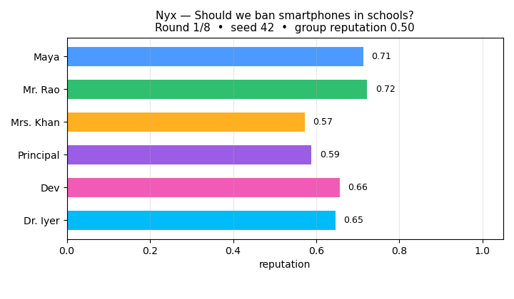

# Nyx – The Decision Intelligence Simulator

> A deterministic future simulator for hard choices.  
> **Live App:** [nyx-crystal-ai.lovable.app](https://nyx-crystal-ai.lovable.app/)

> 🐼 New here? Start with the [beginner explainer](docs/EXPLAINED_FOR_BEGINNERS.md) — plain language, with the seed-42 worked example.
[](https://nyx-crystal-ai.lovable.app/)
[](./public/nyx_kernel.py)
[](https://www.python.org/)

---

**Nyx** takes a complex decision – for example, *"Should we ban smartphones in schools?"* – and builds a miniature society of AI agents. They debate, feel emotions, influence each other, and occasionally crash. The result isn't just a winner; it's a **strategic forecast** that exposes hidden risks, fragile assumptions, key influencers, and a library of "what‑if" scenarios.

At its core runs a **completely deterministic math engine** (the kernel) – the same seed always produces the same outcome, making Nyx scientifically reproducible and fully auditable.

---

## ▶️ See it in action — a worked example



**Question:** *"Should we ban smartphones in schools?"* — 6 agents
(Maya, student; Mr. Rao, teacher; Mrs. Khan, parent; Principal; Dev,
student; Dr. Iyer, researcher), seed `42`, 8 rounds. The GIF above is
the actual run: one frame per round of agent reputations.

**What happens, round by round:**

- The group converges fast: mean reputation climbs 0.50 → 0.65 → 0.84 →
  0.93 → 0.98 → 0.98 → 1.00 → 1.00.
- The story is Dev, the anxious student (starting anxiety 0.7). He
  cascades in rounds 4–5 — the red bar — then recovers from round 6.
  Nobody else crashes.
- **Final outcome vector:** reputation_mean 1.00, inequality 0.069,
  trust_proxy 0.714, centralization 0.139.

**Run it yourself (deterministic — same seed, same numbers):**

```bash
python examples/smartphone_ban.py
```

Or any question with the kernel directly:

```bash
python public/nyx_kernel.py --seed 42 --scenario "ban smartphones in schools" --agents 12
```

---

## 🔮 The Advanced Toggle & Full Control

**Don't forget to turn on the Advanced Toggle** in the live app – it's the gateway to the engine's full power.  
When you enable Advanced Mode, you unlock:

- **Seed control** – Set the exact randomness seed (e.g., `42`) and reproduce any simulation, anywhere.
- **Custom Agent Profiles** – Tweak the 10 psychological variables manually before a run.
- **Batch Experiments** – Run hundreds of trials in one click, explore probability clouds and sensitivity maps.
- **Kernel Inspection** – View and even edit the `nyx_kernel.py` right inside the browser (via Pyodide).
- **Advanced Analytics** – Dive into multi‑trial aggregation, Nash equilibria, Pareto frontiers, and the full Validation Suite.

All the "other features" – Counterfactual Engine, BlackSwan Assassin, Influence Flow, Regret‑Driven Strategy (CFR), Hippocampal Episodic Replay – become directly tweakable in Advanced Mode. It's the difference between watching a simulation and *engineering* one.

---

## 🧠 The AI Agents (The People Inside Nyx)

Every agent has **10 inner psychological variables** (all in `[0,1]`) that evolve during the debate:

| Variable           | Meaning                                                              |
| ------------------ | -------------------------------------------------------------------- |
| Self‑worth         | Confidence in their own position                                     |
| Anxiety            | Reactivity to conflict and pressure                                  |
| Consistency        | Stability of their views                                             |
| Momentum           | Drive to push their agenda                                           |
| Reputation         | How much others trust them                                           |
| Opportunity access | Ability to influence the group                                       |
| Fragility index    | How close they are to an emotional crash ("cascade")                 |
| Lock‑in            | Stubbornness or resistance to change                                 |
| Learning rate      | Speed of adapting to new arguments                                   |
| Energy             | Engagement level                                                     |

These aren't just labels – they **interact mathematically**. A drop in self‑worth might spike anxiety, lower consistency, hurt reputation, and eventually drag others into a cascade. That's what makes the simulation feel real and analytically useful.

---

## 📊 What You Get After a Simulation

- **Winner & Confidence** – The winning position with a confidence percentage (e.g., 72%).
- **Confidence Rubric** – Breakdown of *why* Nyx is confident: Feasibility, Alignment, Risk, Evidence (each scored /10).
- **Best‑Case / Worst‑Case** – Plain‑language ideal and disaster scenarios.
- **Hidden Failure Points** – Risks nobody usually mentions (lack of funding, parental resistance, …).
- **Timeline** – How the consensus shifted round by round.
- **Agent Success Chains** – Who gained momentum and who collapsed.

---

## ⚙️ Core Features (What Nyx Can Do)

| Feature                          | What It Does (Simply)                                                                                                                                   |
| -------------------------------- | ------------------------------------------------------------------------------------------------------------------------------------------------------- |
| **Counterfactual Engine**        | "What if anxiety was 20% higher?" See how outcomes change. Find the most influential variables.                                                           |
| **BlackSwan Assassin**           | Detects the single most fragile assumption everyone is making (e.g., "the debate will stay rational") and shows how breaking it would cascade.           |
| **Leverage Map**                 | A visual graph of who influences whom – instantly spot power players.                                                                                    |
| **Sentiment Ridge**              | Tracks the group's overall confidence round by round.                                                                                                    |
| **Influence Flow (Sankey)**      | Positive (green) and negative (red) influence between agents as a flowing diagram.                                                                        |
| **Narrative Timeline**           | A human‑readable story of key events: cascades, recoveries, BlackSwan alerts.                                                                            |
| **Agent Drill‑Down**             | Full inner dashboard for any agent – all 10 variables over time, mode changes, cascade flags.                                                            |
| **Variable Importance Heatmap**  | Which personality trait fluctuated most for each agent.                                                                                                  |
| **Game Theory Integration**      | Finds Nash equilibria (stable compromises) and Pareto frontiers (best trade‑offs).                                                                        |
| **Multi‑Trial Aggregation**      | Runs many simulations, averages results, and detects pattern types (e.g., "stable convergence" vs "polarized stalemate").                                |
| **Probabilistic Forecasts**      | Gives calibrated chances of success, backlash, or collapse (with warnings that probabilities are simulation‑internal, not real‑world validated).         |
| **Sensitivity & Damping Analysis** | Measures how stable the outcome is – whether shocks fade quickly (over‑damped) or amplify.                                                              |
| **Validation Suite**             | Same seed, same result every time. Ablation tests to check what drives outcomes.                                                                         |
| **Dynamical Primitives**         | Narrative diversity, strongest attractor, network hubs – the "physics" of the debate.                                                                    |
| **Hippocampal Episodic Replay**  | Agents remember high‑salience past events and may replay them when anxious, slightly boosting or hurting self‑worth.                                     |
| **Regret‑Driven Strategy (CFR)** | Agents learn from missed opportunities and adjust their influence targets over time.                                                                     |

---

## 🔧 The Deterministic Kernel – The Honest Heart of Nyx

The kernel is a **single Python file** – [`nyx_kernel.py`](./public/nyx_kernel.py) – that contains all the math behind agent emotions, cascades, and outcome calculations. It is **completely deterministic**: give it the same seed (e.g., `42`) and it will produce the exact same result on any computer, forever.

### What the kernel does

1. **Creates agents** with realistic starting values using a seeded random generator.
2. **Runs the round loop**: perception → cognition → intent emission → world resolution.
3. **Applies exact update equations** for all 10 psychological variables.
4. **Manages failure cascades**, recoveries, mode shifts, and the BlackSwan Assassin.
5. **Outputs** a full `state_history` (all agents, all rounds) and an `outcome_vector` (reputation, inequality, trust, centralization).

### How to use it

- **Standalone Python** – Run it on your laptop, feed it a scenario, get results instantly.
- **In the Nyx web app** – It lives at `public/nyx_kernel.py` and is loaded via Pyodide (Python in the browser). When you click "Run Simulation", the exact same math runs locally – no server required.
- **Batch experiments** – Because it's fast and tiny, you can run thousands of simulations to build probability clouds or sensitivity maps.

> **Why this matters:**  
> ✅ Trust – anyone can inspect the code. No hidden AI bias.  
> ✅ Reproducibility – researchers can verify results.  
> ✅ Speed – the kernel runs in milliseconds, even with many agents.

---

## 🚀 Getting Started

### 🌐 Live App
Visit [nyx-crystal-ai.lovable.app](https://nyx-crystal-ai.lovable.app/).  
**Turn on the Advanced Toggle** (top‑right corner) to unlock all controls.

### 💻 Local Kernel
```bash
git clone https://github.com/jayantt1dubeyy/nyx-crystal-ai.git
cd nyx-crystal-ai
python public/nyx_kernel.py --seed 42 --scenario "ban smartphones in schools" --agents 12
```
You'll get a JSON object with the full state history and outcome vector.

### 🧩 Pyodide Integration
The kernel can be loaded directly in any browser using Pyodide:
```javascript
const kernelCode = await fetch('public/nyx_kernel.py').then(r => r.text());
await pyodide.runPythonAsync(kernelCode);
const result = pyodide.globals.get('run_simulation')(seed=42, scenario="...");
```

---

## 🧪 Reproducibility & Trust

Because every simulation run is seeded, **all visualizations, analyses, and predictions are deterministic**.  
Nyx comes with a built‑in **Validation Suite** that:

- Confirms the same seed → same result (bit‑wise identical).
- Runs ablation studies to identify which variables truly drive outcomes.
- Generates calibration plots for the probabilistic forecasts.

This is not a black‑box oracle – it's a transparent scientific instrument.

---

## 🤝 Contributing

Contributions are welcome! Please open an issue to discuss major changes first.  
The kernel (`public/nyx_kernel.py`) must remain deterministic and pass all validation tests.

1. Fork the repo
2. Create your feature branch (`git checkout -b feature/amazing-feature`)
3. Commit your changes (`git commit -m 'Add some amazing feature'`)
4. Push to the branch (`git push origin feature/amazing-feature`)
5. Open a Pull Request

---

## 📜 License

Distributed under the MIT License. See `LICENSE` for more information.

---

**Nyx is a flight simulator for your hardest choices – now fully explained, inside and out.**  
*Turn on the Advanced Toggle and engineer the future.*
